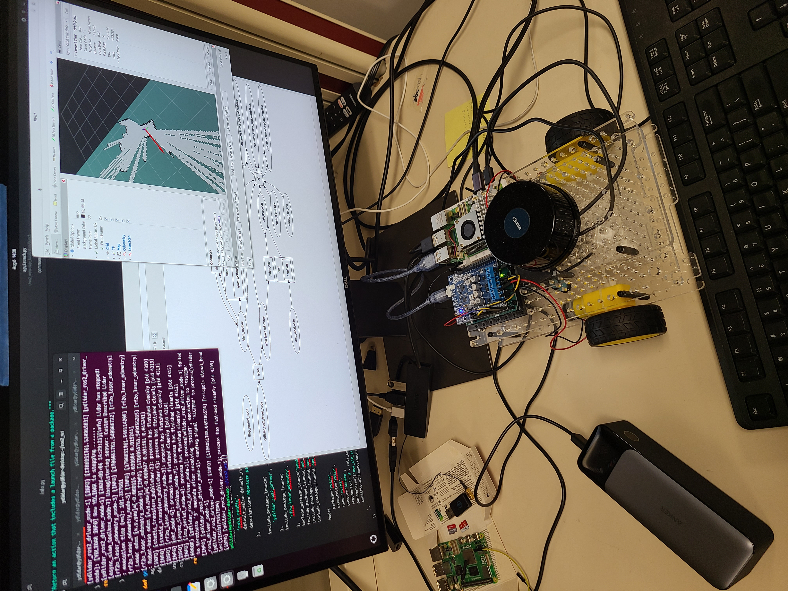
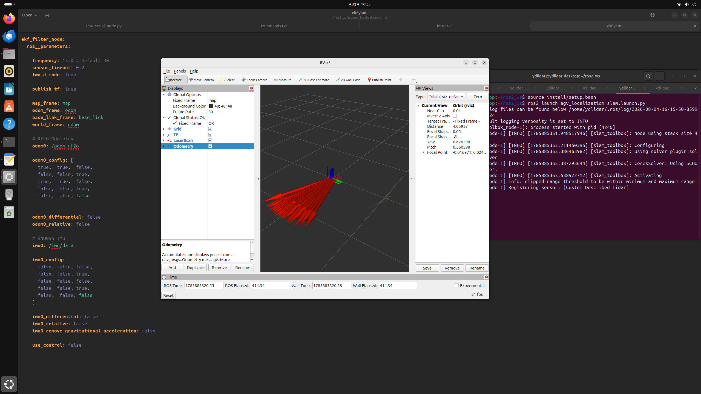
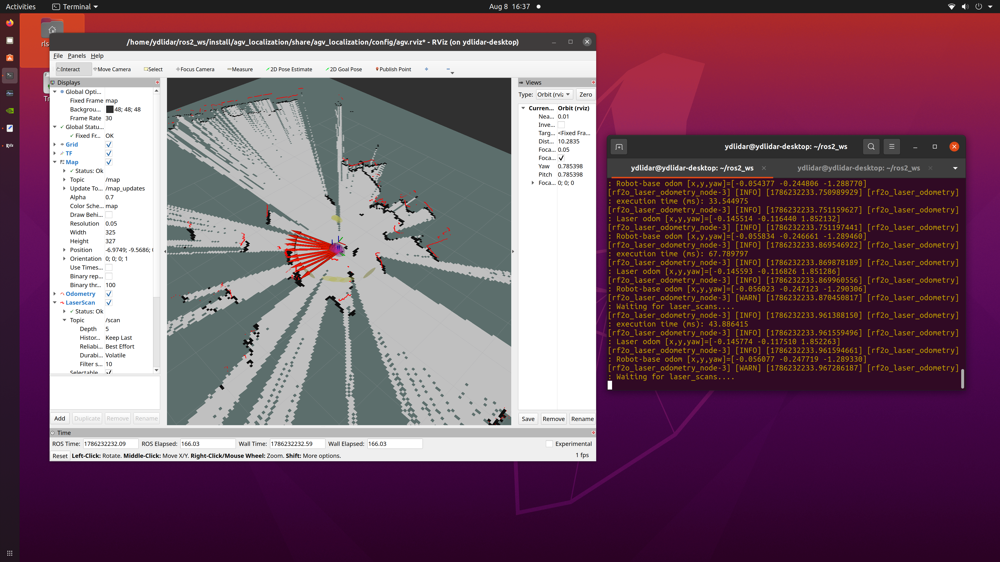
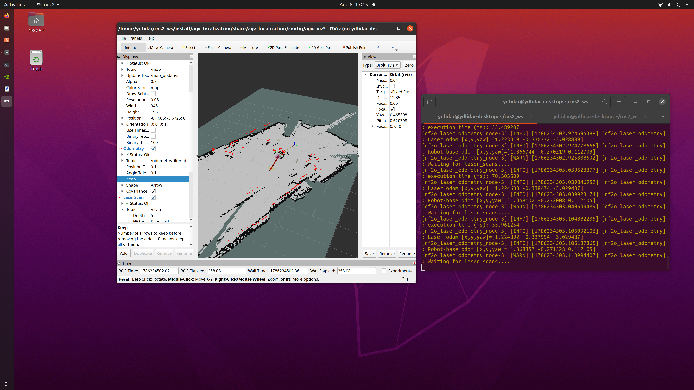

# Encoderless AGV Localization and SLAM

A ROS 2 localization and mapping prototype combining LiDAR odometry
and IMU sensor fusion on a Raspberry Pi 5, without wheel encoders.

## Project Overview

This project develops a 2D localization and mapping pipeline for a small
AGV using ROS 2 Jazzy.

RF2O estimates planar motion from consecutive YDLIDAR TG30 scans.
A BNO055 IMU supplies orientation and angular velocity through an
Arduino Uno and a custom ROS 2 serial interface.

An Extended Kalman Filter (EKF) combines selected laser-odometry and
IMU measurements. SLAM Toolbox uses laser scans and the resulting
transform chain to generate an occupancy-grid map.

The prototype provides a foundation for future wheel-encoder fusion
and autonomous navigation using Nav2.

## My Contributions

- Developed the Arduino firmware and Python ROS 2 serial interface
  for BNO055 sensor data.
- Published standard ROS messages for IMU measurements, magnetic field,
  temperature, and calibration status.
- Integrated YDLIDAR, RF2O, robot_localization, and SLAM Toolbox.
- Configured EKF fusion of RF2O x, y, and yaw with IMU yaw and yaw rate.
- Configured transform ownership and static sensor transforms.
- Integrated a master launch file and RViz configuration.
- Established a rosbag-based stationary IMU covariance-analysis workflow.
- Configured SSH-based remote launch and monitoring.

## System Architecture

- **LiDAR path:** TG30 → /scan → RF2O → /odom_rf2o → EKF
- **IMU path:** BNO055 → Arduino → serial interface → /imu/data → EKF
- **Filtered output:** /odometry/filtered and odom → base_link
- **Mapping:** /scan and TF → SLAM Toolbox → /map and map → odom
- **Visualization:** RViz displays maps, scans, transforms, and odometry.

SLAM Toolbox receives the filtered motion estimate through TF;
it does not directly subscribe to /odometry/filtered in this setup.

## Hardware

- Raspberry Pi 5
- YDLIDAR TG30
- BNO055 IMU
- Arduino Uno
- Portable power bank
- AGV chassis with two brushed DC motors and a Pololu Dual G2 driver

The motor driver and motors were inactive during the documented
mapping tests.

## Software and Technologies

ROS 2 Jazzy • Linux • Python • Arduino/C++ • RF2O •
robot_localization • Extended Kalman Filter • SLAM Toolbox •
RViz • TF2 • rosbag2 • SSH

## Demonstrated Results

- Integrated a launchable encoderless localization and mapping stack.
- Produced occupancy-grid maps during manually pushed indoor tests.
- Published filtered odometry and sensor data for visualization
  and diagnostic monitoring.
- Recorded stationary IMU data and generated covariance-analysis reports.

## Mapping Demonstrations

Occupancy-grid map generated during a manually pushed indoor
mapping test, with laser-scan overlays displayed in RViz.

## Project Documentation

- [View Project Portfolio](./Dak-Amarasinghe-AGV-SLAM-Portfolio.pdf)
- [View Detailed Project Description](./Encoderless-AGV-Localization-and-SLAM-Project-Description.pdf)

The documents include hardware diagrams, software architecture,
mapping screenshots, configuration details, and testing information.

## Current Status and Future Development

Mapping was demonstrated by manually moving the platform.
Powered driving and autonomous goal navigation are future stages.

Next steps include:

- Measuring and validating sensor mounting transforms.
- Repeating IMU calibration and covariance tests under representative
  operating conditions.
- Comparing alternative EKF sensor-fusion configurations.
- Commissioning motor control and integrating wheel-encoder odometry.
- Integrating Nav2 after reliable localization and actuation are available.

## Technologies Used and Attribution

This project integrates existing YDLIDAR, RF2O, robot_localization,
SLAM Toolbox, and Adafruit components. My work focuses on the custom
sensor interface, configuration, adaptation, testing, and integration
of the complete mapping system.

## Author

**Dakshitha (Dak) Amarasinghe**

[GitHub Portfolio](https://github.com/DakAmarasinghe1994) |
[LinkedIn](https://www.linkedin.com/in/dak-amarasinghe-946aa71b1/)
